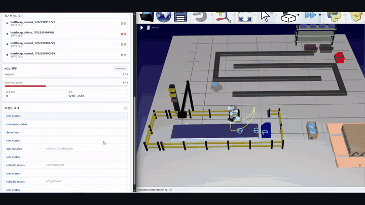
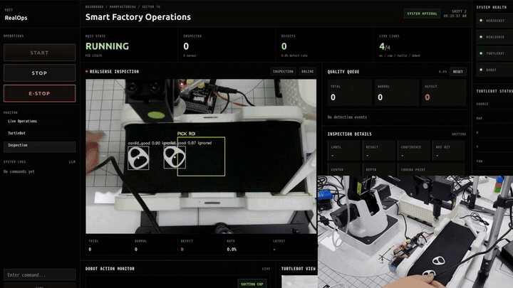

# AQIS for SmartFactory

> 실제 장비의 품질 검사·로봇 분류와 디지털 트윈을 연결한 스마트팩토리 프로젝트

[프로필](../README.md) · [프로젝트 목록](README.md)



*현은빈이 담당한 RoboDK 디지털 트윈·Simulation Dashboard 영역의 시연입니다.*

| 항목 | 내용 |
| --- | --- |
| 과정 | SSAFY 15기 광주 4반 3조 |
| 기간 / 인원 | 2026.06 · 4주 · 2명 |
| 내 역할 | Simulation·AI·3D |
| 주요 기술 | RoboDK, YOLOv5, Roboflow, Onshape, React |
| 팀 통합 환경 | ROS 2 Humble, RealSense, Dobot, TurtleBot3, FastAPI, WebSocket |

## 문제와 접근

품질 검사 공정은 카메라, 컨베이어, 로봇팔과 관제 화면이 함께 동작해야 합니다. 실제 장비를 사용하기 전에도 공정 흐름을 개발할 수 있도록 디지털 트윈과 시뮬레이션 대시보드를 먼저 구성했습니다.

팀은 실제 장비와 시뮬레이션의 실행 환경을 구분하면서 공통 백엔드와 이벤트 모델을 사용하는 방향으로 통합했습니다.

## 현은빈의 기여

- **RoboDK 디지털 트윈:** 로봇팔·컨베이어·이동로봇·공장 자산을 배치하고 검사·분류·운반 공정 시나리오와 로봇 공정 스크립트를 구현했습니다.
- **Simulation Dashboard:** 실제 장비 UI에 앞서 시뮬레이션 상태와 공정 흐름을 확인하는 화면을 개발했습니다.
- **AI 모델:** Roboflow 데이터 구성·라벨링과 캔 뚜껑 정상·불량 YOLO 모델 학습을 담당했습니다.
- **3D 설계:** Onshape로 부품을 설계하고 3D 프린팅 자산을 제작했습니다.
- **공동 내비게이션:** ROS 패키지를 활용한 SLAM 지도 작성과 TurtleBot3 지정 목표점 주행을 함께 구성했습니다.

## 팀의 실제 장비 시연



```text
캔 뚜껑 투입 → RealSense·YOLO 검사 → 불량 이벤트
→ 컨베이어 정지 요청 → Dobot 분류 → 공정 재개 → 관제 반영
```

실제 장비의 ROS 통합, FastAPI·RealOps·ROS 브리지, 영상 전송 분리와 컨베이어·Dobot 연동은 공세민의 주요 담당 영역입니다. 위 시연은 팀 통합 결과이며, 현은빈의 개인 기여는 시뮬레이션·학습·3D 설계로 구분합니다.

## 설계 판단

| 제약 | 선택한 방식 | 의미 |
| --- | --- | --- |
| 초기에는 실제 장비 사용이 제한됨 | 디지털 트윈과 시뮬레이션 화면 선개발 | 장비 준비와 공정 개발을 병행 |
| 실제·모의 실행의 조건이 다름 | 환경별 연결을 분리하고 공통 이벤트 사용 | 같은 공정 개념으로 연동 |
| 검사와 분류가 여러 단계에 걸침 | 공정 상태와 관제 이벤트 연결 | 현재 단계와 진행 흐름을 확인 |
| 디지털 환경과 물리 부품이 함께 필요함 | RoboDK 배치와 Onshape 설계 병행 | 공정 시나리오와 실제 제작을 함께 고려 |

## 구현 결과와 검증 범위

**확인:** 프로젝트 기록과 시연에서 RoboDK 디지털 트윈, Simulation Dashboard, 실제 품질 검사·Dobot 분류, 상태 관제와 ROS 패키지 기반 SLAM·목표점 주행 구성을 확인했습니다.

**질문/미정:** 독립 테스트셋의 최종 검사 성능, 장시간 공정의 오탐·미탐률, 분류 반복 성공률과 전체 사이클 시간은 이 소개의 확정 성과로 사용하지 않았습니다. 공정 이벤트에 따른 이동로봇의 자동 출동·반복 임무도 후속 범위로 구분합니다.

## 배운 점

실제 장비가 준비될 때까지 기다리기보다 공통 상태와 이벤트를 먼저 정하고 시뮬레이션으로 공정을 확인하는 방법을 배웠습니다. 시뮬레이션이 동작하는 것과 실물 공정의 반복 성능을 확인하는 것은 다른 단계라는 점도 분명해졌습니다.

원본 코드·장비 연결 정보·내부 실행 문서는 비공개로 관리합니다.
