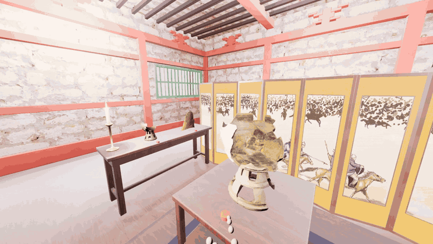

# BONDI · 본디

> 손상된 유물의 결손 형상을 AI로 복원하고 VR 박물관에서 비교하는 체험형 프로젝트

[프로필](../README.md) · [프로젝트 목록](README.md)



*VR 전시는 팀의 공동 결과이며, 현은빈은 유물의 결손 형상 복원과 메시화를 담당했습니다.*

| 항목 | 내용 |
| --- | --- |
| 과정 | SSAFY 15기 특화 프로젝트 |
| 기간 / 인원 | 2026.08–09 · 4주 · 7명 |
| 내 역할 | AdaPoinTr 점군 완성, 학습 데이터·평가, 회전 TTA, 메시화 |
| 주요 기술 | Python, PyTorch, AdaPoinTr, Point Cloud, Blender |
| 팀 전시 환경 | Unreal Engine 5, OpenXR, Meta Quest 2 |
| 수상 | 2026 SSAFY 15기 2학기 특화 프로젝트 우수상 · 광주 2반 2등 |

## 문제와 접근

같은 유물의 손상 상태와 완형 상태를 함께 담은 3D 학습 쌍을 확보하기 어려웠습니다. 완형 유물 3D에 여러 결손 패턴을 합성해 학습 쌍을 만들고, 점군 완성 모델이 사라진 형상을 추정하도록 구성했습니다.

AI 결과는 역사적 정답이 아닌 복원 가설로 다뤘습니다. 남아 있는 관측부와 모델이 추정한 부분을 구분하고 VR에서 손상·복원 상태를 비교하도록 연결했습니다.

## 팀의 전체 흐름

```text
2D 유물 이미지 → 손상 상태 3D 생성 → 점군 변환
→ AdaPoinTr 결손 형상 추정 → 메시화·재질 복원 → VR 박물관
```

이미지 기반 3D 생성, 표면·재질 복원, VR 공간·입력·최적화는 팀원들과 역할을 나눠 진행했습니다.

## 현은빈의 기여

- **학습 데이터:** 완형 형상에 결손 패턴과 변형을 합성하고 형상 단위 train/validation/test 분할을 구성했습니다.
- **형상 복원:** AdaPoinTr 기반 점군 완성 경로를 구현하고 유물 도메인에 맞춰 파인튜닝했습니다.
- **회전 TTA:** 여러 방향에서 추론한 후보를 모아 결손 영역의 예측 범위를 넓혔습니다.
- **평가 개선:** 좌표 정규화 과정의 벤치마크 누출을 찾아 수정하고, 전체 거리 지표와 결손부 커버리지를 함께 비교했습니다.
- **메시화:** 관측부 메시를 유지하고 AI가 생성한 면을 별도 노드로 내보내는 경로를 구현했습니다.
- **대조 실험:** 회전대칭 복원과 PCA 형상 사전을 비교하고 적용 조건을 정리했습니다.

## 핵심 설계 판단

| 문제 | 선택한 방식 | 의미 |
| --- | --- | --- |
| 같은 유물이 학습·평가에 섞일 수 있음 | 형상 단위로 데이터 분할 | 동일 형상 누출을 줄여 평가 |
| 전체 점군 거리만으로 결손 복원이 잘 드러나지 않음 | 결손부 커버리지와 F-score 함께 확인 | 복원해야 할 부분의 결과를 별도로 평가 |
| 단일 방향 추론에서 후보 영역이 좁음 | 회전 TTA 적용 | 여러 방향의 추정을 결합 |
| 원래 표면과 생성 표면의 구분이 사라짐 | 관측부와 AI 생성 면 분리 | 복원 근거를 추적할 수 있게 보존 |

## 구현 결과와 검증 범위

아래 수치는 기존 프로젝트의 최종 평가 기록이며 이번 소개 작성에서 다시 측정한 값은 아닙니다.

| 항목 | 기존 기록 | 해석 범위 |
| --- | --- | --- |
| 최종 학습·평가 데이터 | 19개 형상·2,280쌍 | train 14형상 / validation 2형상 / test 3형상 |
| 회전 TTA | 결손 후보 영역 커버리지 5.2% → 28.0% | 예측점이 놓인 후보 격자의 비율 |
| 깊은 결손 구간 F-score | 사전학습 0.026 → 파인튜닝 0.918 | 합성 결손의 특정 테스트 구간 결과 |
| 관측·추정 분리 | 관측부와 생성 면을 별도 노드로 저장 | 원래 관측된 영역과 AI 추정부를 구별 |

**확인:** 위 데이터 구성·평가·메시화 결과는 프로젝트 기록에서 확인했습니다.

**질문/미정:** 실제 문화재의 역사적 정합성은 이 평가로 입증하지 않습니다. 완형 데이터에도 생성 모델의 추정이 포함되며, 회전대칭 보완은 대상 형상에 따라 적용 범위가 제한됩니다.

## 배운 점

모델의 전체 점수가 좋아지는 것과 실제 결손부가 복원되는 것은 다를 수 있었습니다. 평가 지표와 데이터 분할을 먼저 검토하고, 관측된 부분과 AI가 만든 부분을 구분해야 결과를 설명할 수 있다는 점을 배웠습니다.

원본 코드·모델 가중치·학습 데이터·전시 자산 원본은 비공개로 관리합니다.
