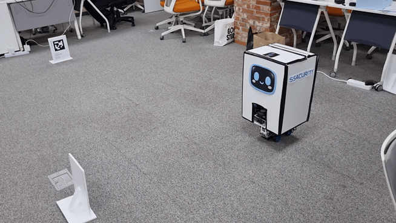

# SSACURITY · 싸큐리티

> AprilTag 기반 자율주행 로봇으로 셔틀 승강장 출입을 관제하는 보안 시스템

[프로필](../README.md) · [프로젝트 목록](README.md)



*실제 로봇의 경로 주행 시연입니다. 아래의 자동 시험 수치와는 다른 확인 자료입니다.*

| 항목 | 내용 |
| --- | --- |
| 과정 | SSAFY 15기 공통 프로젝트 · Team C207 |
| 기간 / 인원 | 2026.07–08 · 6명 |
| 내 역할 | Jetson·AprilTag 자율주행, UART·관제 연동 |
| 주요 기술 | ROS 2 Humble, Python, OpenCV, AprilTag, Jetson Orin Nano, STM32 |

## 문제와 접근

셔틀 승강장에서는 운행 시간마다 보안 요원이 태깅 장비를 설치·회수해야 했습니다. 팀은 이 반복 업무를 로봇으로 옮기고, 태깅·무단 통과·로봇 상태를 관제 화면에서 확인하는 시스템을 만들었습니다.

저는 로봇이 승강장과 충전 위치를 오갈 수 있도록 AprilTag 위치 추정, 왕복 경로 상태머신과 Jetson–STM32 통신을 맡았습니다.

## 시스템 개요

```text
카메라 → Jetson의 AprilTag 인식·경로 판단 ↔ STM32 주행 제어
                       ↕
                    관제 서버 ↔ 대시보드
                       ↑
               RFID·ToF 게이트 이벤트
```

STM32 하위 제어, 게이트 장치, 서버·AI·대시보드는 팀원들과 역할을 나눠 구현했습니다.

## 현은빈의 기여

- **위치 추정:** OpenCV 기반 태그 검출과 카메라 좌표계 변환으로 종방향 거리·횡방향 오차를 계산했습니다.
- **경로 상태머신:** 출발·직진·회전·도착·U턴·복귀 흐름을 구현했습니다. 회전 구간은 하위 제어기의 yaw 관측을 사용했습니다.
- **예외 처리:** 일시 태그 손실, 최대 주행거리·시간, 장애물 대기와 명시적 복구가 필요한 오류 상태를 구분했습니다.
- **통신:** Jetson–STM32 UART 프레임, CRC와 스트림 파서를 구성하고 관제 WebSocket을 연결했습니다.
- **검증 환경:** 실제 카메라·차량 없이 경로 로직을 확인할 수 있도록 가상 STM32와 폐루프 코스 시뮬레이터를 구성했습니다.

## 주요 문제와 해결

| 문제 | 선택한 방식 |
| --- | --- |
| 카메라에서 태그를 잠시 놓침 | 직전 진입 방향을 활용하되 거리·시간 제한을 계속 감시 |
| 회전 중 태그 관측이 불안정함 | yaw 누적값으로 회전 진행 판단 |
| 장애물 대기와 고장 상태를 같은 방식으로 처리함 | 일시 대기와 명시적 재무장이 필요한 오류를 분리 |
| 실제 장비를 항상 사용할 수 없음 | 통신·경로의 핵심 로직과 모의 실행 환경 분리 |
| 통신 스트림이 프레임 경계와 일치하지 않음 | CRC와 스트림 파서로 분할·연속 입력 처리 |

## 구현 결과와 검증 범위

**확인:** 기존 프로젝트 정리 기록에서 ROS 비의존 핵심 로직 시험 243개 통과와 모의 폐루프 E2E 시나리오 5/5 통과를 확인했습니다. 이번 소개 작성에서 시험을 다시 실행하지 않았습니다.

| 자료 | 확인한 범위 | 확대해서 말할 수 없는 결과 |
| --- | --- | --- |
| 실제 주행 시연 | 로봇의 경로 주행 장면 | 장기 운행 성공률·전체 환경 대응 |
| 핵심 로직 시험 | CRC·파서·오도메트리·태그 기하·경로 로직 | 전체 ROS 실행·실물 시스템 시험 |
| 모의 폐루프 E2E | 출발·복귀·중단·오류 유지·리셋 흐름 | 실제 차량에서 5회 연속 성공했다는 의미 |

**질문/미정:** 장기 운행의 반복 성공률, 다양한 조도·장애물 조건의 정량 평가와 전체 출입 판정 정확도는 이 소개의 확인 범위에 포함하지 않습니다.

## 배운 점

인지와 주행 사이에는 ‘지금 믿을 수 있는 관측인가’라는 판단이 필요했습니다. 정상 경로뿐 아니라 관측 손실·정지·오류 복구를 상태로 표현하고, 장비가 없는 환경에서도 통신과 경로 로직을 확인할 수 있게 만드는 경험을 했습니다.

원본 소스코드·장비 설정·내부 실행 문서는 비공개로 관리합니다.
