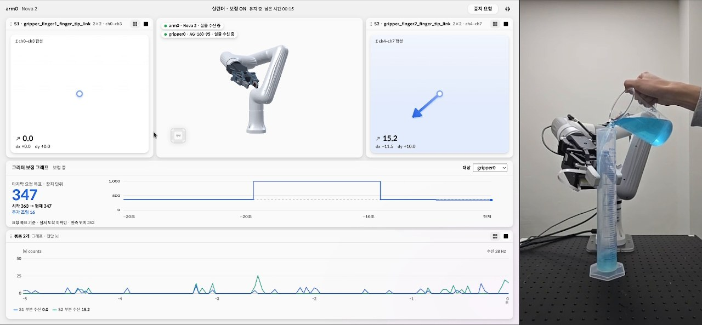

# Tac-Touch · 택터치

> 촉각센서와 그리퍼를 잇는 PC 통신·실행 관리 시스템

[프로필](../README.md) · [프로젝트 목록](README.md)



*물을 부어 무게가 늘어난 실린더가 미끄러지기 시작하자, 오른쪽 손가락 센서가 움직임을 감지하고(↗ 15.2) 그리퍼가 위치 363 → 347로 16만큼 더 조여 보정하는 실물 시연 장면입니다. 미끄러짐 감지·보정 알고리즘과 최종 GUI는 팀 작업이며, 현은빈은 센서 데이터가 PC 코어와 Gateway를 거쳐 화면까지 오는 통신·공용 API·실행 관리를 맡았습니다.*

| 항목 | 내용 |
| --- | --- |
| 과정 | SSAFY 15기 자율 프로젝트 · 택로봇 기업 연계 |
| 기간 / 인원 | 2026.10–11 · 6명 |
| 목표 | 촉각센서 수집 → 미끄러짐 감지 → 그리퍼 보정 → PC 모니터링 |
| 내 역할 | Gateway·공용 API·PC 통합, 메인 런처·시나리오 실행 관리 |
| 주요 기술 | Python, WebSocket, USB Serial, ROS 2, Ubuntu·Windows |

## 문제와 접근

센서, 감지 알고리즘, 그리퍼 제어와 GUI를 여러 사람이 나눠 개발하면서 데이터 형식과 실행 주기를 맞춰야 했습니다. 장비를 사용할 수 없는 기간에도 각 모듈의 개발과 통합을 이어갈 필요가 있었습니다.

저는 모듈 사이의 공통 데이터 계약과 PC 통신 계층을 설계했습니다. 센서 입력을 앱에서 사용하는 형식으로 바꾸고, GUI와 시나리오가 같은 API로 상태를 확인하고 요청하도록 연결했습니다.

## 현은빈의 기여

- **데이터 계약:** 센서·감지·제어·GUI의 공통 메시지와 모듈 경계를 정리하고, 관련 담당자의 리뷰를 반영했습니다.
- **센서 수신:** 포트 탐색, 연결 관리, 줄 단위 수신과 CSV 파싱을 구현했습니다. 헤더 이름으로 열을 읽고 무효 입력·USB 단절을 처리했습니다.
- **Gateway·공용 API:** 상태 전송, 접속 시 현재 상태 복원, 호출자 권한과 요청 범위·중복·만료 처리를 구현했습니다.
- **런처·시나리오:** 프로세스의 시작·준비·종료와 장비 예약, 생존 확인, 단절·복구를 관리하는 계약과 모의 실행 경로를 구현했습니다.
- **연결·통합:** 기존 시연 흐름을 막지 않는 관측 경로와 ROS 그리퍼 상태·명령 연결을 다뤘습니다.
- **기록·문서:** Windows의 기록 저장·인코딩·종료 문제를 수정하고 통신 구조와 발표자료를 정리했습니다.

## 통합 구조

```text
촉각센서·MCU → PC 수신·파싱 → PC 코어 → Gateway → GUI
                              ↑
                     런처·시나리오 실행 관리
                              ↓
                         ROS 장비 연결
```

전체 연결을 설명하기 위한 개요입니다. 감지·보정 알고리즘, 최종 GUI와 제조사 드라이버 전체를 개인 구현으로 주장하지 않습니다.

## 주요 설계 판단

| 문제 | 선택한 방식 |
| --- | --- |
| 센서 출력 형식 변경 | 열 위치 대신 헤더 이름으로 해석하고 앱 데이터 모델로 변환 |
| 수집과 화면 갱신 속도 차이 | 수신·기록과 화면 표시 갱신의 경계 구분 |
| 단절 뒤 이전 요청·상태 재사용 | 연결·실행 식별과 만료 처리, 복구 조건 구분 |
| 발행 성공과 실제 장비 동작의 차이 | 명령 전달 결과와 별도 상태 관측 구분 |
| 기존 시연에 관측 추가 | 관측 전송이 본 작업을 기다리게 하지 않도록 분리 |

## 확인한 결과와 한계

**확인:** 공통 계약, 수신·파서, Gateway, 런처와 관련 시험 코드의 작성 이력을 확인했습니다. 실물 그리퍼는 별도의 제한된 시험 경로에서 명령 전달과 도달 관측을 기록했습니다.

**질문/미정:** 전체 자동 파지·인계의 최종 실물 통합, 장시간 반복 성능과 전체 감지→보정 지연 목표 달성 여부는 이 소개의 확인 범위에 포함하지 않았습니다. 화면의 수신 표시도 실제 제어 성능을 입증하는 자료로 사용하지 않습니다.

## 배운 점

통합은 데이터 형식뿐 아니라 실패, 단절, 재연결과 종료 때의 동작을 합의하는 일이었습니다. 다음에는 초기에 센서 한 줄 수신부터 실물 명령 한 번까지 연결하고, 시연과 같은 환경에서 측정 조건을 먼저 정하려고 합니다.

기업 공개 조건에 따라 개요·개인 경험·화면 캡처 수준으로 작성했습니다. 기업 원본 자료, 소스코드, 내부 API 명세와 장비 파라미터는 공개하지 않습니다.
